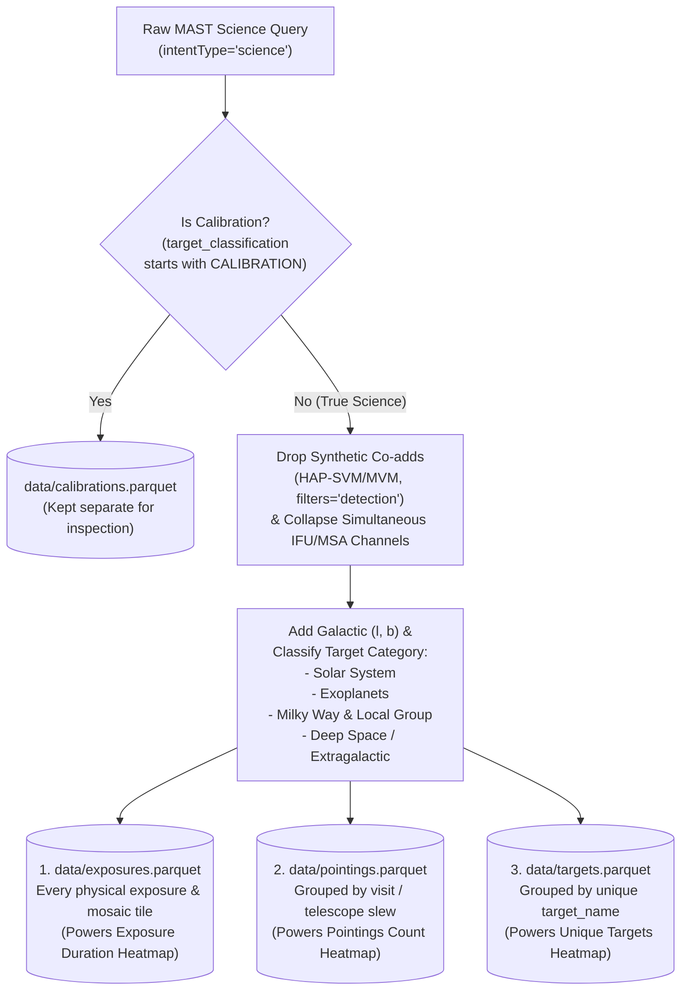

# Space Telescopes Observation Heatmap — Project Blueprint & Plan

> Consolidated from the initial design conversation, architectural refinements, and early data-exploration findings. This document records the original blueprint and implementation history; parts predate the current memory optimizations and newer features. For current development guidance, start with [AGENTS.md](./AGENTS.md), [README.md](./README.md), and the [performance notes](./docs/performance.md), then check the relevant implementation and tests.

---

## 1. Project Vision & Scope

An open-source Python application and interactive web dashboard that visualizes where major space observatories (starting with **Hubble (HST)** and **James Webb (JWST)**, and extensible to **Chandra**, **Spitzer**, **XMM-Newton**, **Euclid**, **Herschel**, **Kepler**, and **TESS**) have pointed throughout their mission lifetimes.

Instead of downloading terabytes of raw astronomical imagery, the project queries observation **metadata catalogs** to build spherical heatmaps showing where humanity's space telescopes have spent the most time, pointed most frequently, or observed the most unique targets.

### Key Capabilities & Interactive Toggles
- **Spherical & Projected Heatmaps:**
  - **3D Interactive Globe:** Users can spin, zoom, and inspect the celestial sphere in their browser, featuring explicit visual markers for the **Galactic Center** $(l = 0^\circ, b = 0^\circ)$ and the **Galactic Plane** ($b = 0^\circ$).
  - **2D All-Sky Projection:** Flattened **Mollweide projection** (both interactive in the app and exported as static high-res images for the GitHub `README.md`).
- **Interactive Filtering & Display Controls:**
  - **Telescope Selector:** Switch between observatories (`HST`, `JWST`, etc.) or view combined/comparative maps.
  - **Reference Frame Toggle:** Switch between **Galactic Coordinates** $(l, b)$ centered on the Milky Way center $(l = 0^\circ, b = 0^\circ)$ and **Equatorial Coordinates** $(\text{RA}, \text{Dec})$.
  - **Heatmap Metric / Dataset Toggle (Backed by Dedicated Tables):**
    1. **Exposure Time (`exposures.parquet`):** Cumulative exposure duration (`t_exptime`) across every physical sky tile/exposure, preserving full spatial fidelity across mosaics.
    2. **Telescope Pointings (`pointings.parquet`):** Counts each physical telescope slew/visit to a sky position, showing how often the telescope moved to point at a region regardless of exposure duration.
    3. **Unique Targets (`targets.parquet`):** Counts distinct astronomical targets observed in each sky pixel.
  - **Color Scale Toggle:**
    - **Logarithmic Scale ($\log_{10}$):** Brings out the full structure of the sky so ultra-deep fields don't wash out shallower surveys.
    - **Linear Scale (with optional percentile clipping):** Shows the raw, unscaled concentration of telescope time, pointings, or targets.
  - **Target Category Filters:** Dynamically include or exclude:
    - **Solar System:** Moving targets (planets, moons, asteroids, comets, Kuiper Belt objects).
    - **Exoplanets & Protoplanetary Disks:** Dedicated filter for extrasolar planet transits, direct imaging, and circumstellar disks.
    - **Milky Way & Local Group:** Galactic disk ($|b| < 10^\circ$), stars, nebulae/ISM, star clusters, and Magellanic Clouds (LMC/SMC).
    - **Deep Space / Extragalactic:** Galaxies, AGN/quasars, galaxy clusters, supernovae, and cosmological deep fields.
    - **Calibrations (Optional Separate View):** Stored separately in `calibrations.parquet` so they never pollute science maps but remain inspectable if desired.

---

## 2. Technical Stack & Tooling

| Component | Technology | Role & Justification |
| :--- | :--- | :--- |
| **Python & Package Manager** | **Python 3.12** + **`uv`** | `uv` manages both the Python 3.12 installation and project dependencies/virtualenv via `pyproject.toml` and `uv.lock`. |
| **Version Control** | `git` + `gh` | Synced with GitHub (`JustMohsen/space-telescopes-observation-heatmap`), ignoring large local `.parquet` datasets. |
| **Data Retrieval** | `astroquery.mast` | Queries STScI's Mikulski Archive for Space Telescopes (MAST) filtering server-side for `intentType='science'` in resumable time chunks. |
| **Coordinate Math** | `astropy.coordinates` (`SkyCoord`) | Translates native Equatorial coordinates ($\text{RA}, \text{Dec}$) into Galactic coordinates $(l, b)$ centered on $(0^\circ, 0^\circ)$. |
| **Spherical Binning** | `healpy` (HEALPix) | Subdivides the sphere into equal-area pixels (`NSIDE` resolution), aggregates exposure times, pointing counts, or target counts, and interpolates onto a 3D meshgrid. |
| **Data Storage & Processing** | `pandas` + `pyarrow` | Cleans, deduplicates, and exports four structured `.parquet` tables (`exposures`, `pointings`, `targets`, `calibrations`). |
| **Interactive Visualization** | `plotly.graph_objects` / `matplotlib` | Renders interactive 3D globes and 2D projections in the browser (`plotly`), plus static publication-quality Mollweide maps (`matplotlib`). |
| **Web Application UI** | `streamlit` | Pure-Python reactive web framework that turns `app.py` directly into an interactive browser website. |

---

## 3. Repository & Folder Structure

```text
Space Telescopes Observation Heatmap/
├── .git/                           # Git version control
├── .gitignore                      # Ignores .venv/, data/*.parquet, *.pdf, __pycache__
├── .python-version                 # Pins Python 3.12 for uv
├── pyproject.toml                  # Project metadata & dependencies
├── uv.lock                         # Exact locked dependency versions
├── README.md                       # Open-source project overview & usage instructions
├── telescope_heatmap_blueprint.md  # Living architecture & implementation roadmap
├── data/                           # Local raw chunks & output .parquet tables (git-ignored)
│   ├── chunks/                     # Cached per-window raw MAST downloads
│   ├── exposures.parquet           # Physical exposures (for Exposure Time heatmap)
│   ├── pointings.parquet           # Deduplicated telescope visits/slews (for Pointings heatmap)
│   ├── targets.parquet             # Unique astronomical targets (for Targets heatmap)
│   └── calibrations.parquet        # Residual calibration observations (kept separate from science)
├── scripts/
│   ├── explore_mast.py             # Step 1: Inspect real MAST columns & target tags
│   └── run_etl.py                  # Step 2: CLI entrypoint to run the offline ETL pipeline
├── src/
│   └── telescope_heatmap/
│       ├── __init__.py
│       ├── config.py               # Constants, paths, & telescope mission definitions
│       ├── etl.py                  # MAST fetching, cleaning, & 4-table normalization
│       ├── coordinates.py          # Astropy (RA/Dec -> l, b) & target classification logic
│       ├── binning.py              # HEALPix spherical binning (time/pointings/targets, log/linear)
│       └── viz.py                  # 3D Plotly globe & 2D Mollweide chart builders
├── tests/                          # Unit tests for coordinate math, classification, & deduplication
└── app.py                          # Streamlit web application entrypoint
```

---

## 4. Data Nuances Discovered in Step 1 & Multi-Table Architecture

Inspecting live MAST data for **HST** and **JWST** revealed several crucial archive behaviors that shaped our multi-table ETL design:

### 4.1 Why MAST Has Duplicate/Multi-Row Entries (Physics & Archive Mechanics)
1. **HST Synthetic Mosaic Stacks (`HAP-SVM`, `HAP-MVM`, and `filters="detection"`):**
   - When Hubble steps across multiple sky positions in a mosaic (e.g. across the Andromeda Galaxy `M31`), the primary instrument pipelines (`CALWF3`, `CALACS`, `CALSTIS`, `CALCOS`) record **every individual tile pointing and filter exposure** with its true $(\text{RA}, \text{Dec})$ and exposure duration.
   - However, MAST *also* stores post-processed **Hubble Advanced Products (`HAP-SVM` / `HAP-MVM`)** and synthetic white-light `"detection"` rows that stack multiple filters together and sum their exposure times into a second duplicate entry at the same position.
   - **How We Handle It:** We exclude synthetic re-stacked products (`provenance_name` in `{'HAP-SVM', 'HAP-MVM', 'HASP', 'HSLA'}` and `filters == 'detection'`) while **keeping every individual physical exposure and mosaic tile pointing** from the primary instrument pipelines. Thus, zero spatial mosaic fidelity is lost, and exposure time is never double-counted.
2. **JWST Simultaneous Channels (`MIRI/IFU`) & Micro-Shutters (`NIRSpec/MSA`):**
   - *Note on JWST Optics:* All 18 hexagonal primary mirror segments focus light into a single combined telescope beam—the multiple rows in MAST are not from the 18 mirror segments, but from how JWST's instruments split or sample that focal plane during a single pointing:
     - **MIRI IFU (12 rows per pointing):** Internal dichroic beam-splitters divide the light from the exact same $3.7'' \times 3.7''$ ($0.001^\circ$) spot on the sky into 4 wavelength channels $\times$ 3 sub-bands simultaneously, creating 12 catalog rows with identical timestamps (`t_min`) and exposure durations (`t_exptime`).
     - **NIRSpec MSA (100+ rows per pointing):** A grid of microscopic shutters covers a $3.6' \times 3.4'$ ($0.06^\circ$) field of view. During a single deep-field pointing, ~100 shutters open simultaneously to take spectra of 100 galaxies, and MAST saves 1 row per shutter.
   - **How We Handle It:** Because simultaneous channel/shutter rows share the same `(obs_collection, proposal_id, instrument_name, t_min)` timestamp, collapsing simultaneous sub-band/shutter readouts into a single exposure record preserves the exact sky position and true exposure duration (`t_exptime`) without multiplying 1 hour of telescope time by $12\times$ or $100\times$.

### 4.2 Four Output Tables Produced by the ETL Pipeline
Instead of forcing one table to serve every purpose, `etl.py` produces four clean Parquet tables:



1. **`data/exposures.parquet` (Exposure-Level Science Table):**
   - Contains every distinct physical exposure (including every individual tile in a multi-tile mosaic).
   - Used when the user selects **Exposure Time** on the heatmap so every tile of a mosaic contributes its exact duration at its exact coordinates.
2. **`data/pointings.parquet` (Telescope Visit / Slew Table):**
   - Groups consecutive/simultaneous exposures at the same sky coordinates within a visit into a single telescope pointing event.
   - Used when the user wants to see **where the telescope moved/pointed most frequently** (`Pointing Count`), along with total visit duration and number of exposures per visit.
3. **`data/targets.parquet` (Unique Targets Table):**
   - Aggregates all observations of each unique astronomical target (`(obs_collection, target_name)`), storing its representative coordinates $(\text{RA}, \text{Dec}, l, b)$, target category, total pointings, and cumulative exposure time.
   - Used when the user toggles **Unique Targets** on the heatmap or inspects the top-observed targets table.
4. **`data/calibrations.parquet` (Calibration Table):**
   - Stores observations flagged as `CALIBRATION;...` (or `target_name` calibration standards) separately so they don't bias science maps, while remaining available if the user wants to inspect calibration pointings.

### 4.3 Multi-Category Target Classification (`coordinates.py`)
Every science row is tagged with both boolean flags and a primary `target_category` enum:
1. **`solar_system`:** `mtFlag == True` OR `target_classification` / `target_name` matches Solar System bodies (planets, moons, asteroids, comets, KBOs, centaurs), **explicitly excluding** `EXTRA-SOLAR`, `EXOPLANET`, `PROTOPLANETARY`, and `PLANETARY NEBULA`.
2. **`exoplanet`:** `target_classification` or `obs_title` matches `EXTRA-SOLAR PLANET`, `EXOPLANET`, `PROTOPLANETARY DISK`, or `DEBRIS DISK` (and `mtFlag == False`).
3. **`milky_way`:** Non-Solar-System, non-Exoplanet targets that either:
   - Have `target_classification` matching Galactic objects (`STAR`, `ISM`, `NEBULA`, `GLOBULAR CLUSTER`, `OPEN CLUSTER`, `NOVA`, `PULSAR`, `WHITE DWARF`, `BROWN DWARF`, `SUPERNOVA REMANT`), OR
   - Lie within the Galactic plane ($|b| < 10^\circ$) or Magellanic Clouds (LMC/SMC bounding boxes) when `target_classification` is unclassified/blank.
4. **`deep_space`:** Extragalactic targets (`GALAXY`, `QUASAR`, `AGN`, `BLAZAR`, `SEYFERTS`, `CLUSTER OF GALAXIES`, `HIGH REDSHIFT`, `SUPERNOVA TYPE IA/II`, `DEEP FIELD`, `BLANK FIELD`) or high-latitude pointings ($|b| \ge 10^\circ$) outside the Milky Way/LMC/SMC.

---

## 5. Living Implementation Roadmap

- [x] **Step 0: Repository & Environment Setup (`uv` + Python 3.12 + Git + GitHub)**
  - Installed `uv` (`0.13.7`), pinned Python 3.12 (`3.12.15`), initialized Git, created GitHub repository [JustMohsen/space-telescopes-observation-heatmap](https://github.com/JustMohsen/space-telescopes-observation-heatmap), and installed all 63 dependencies.
- [x] **Step 1: Data Exploration & Prototype Query (`scripts/explore_mast.py`)**
  - Explored 1-month samples and full-mission counts for HST & JWST; identified HST `HAP` mosaic co-adds, JWST simultaneous IFU/MSA rows, residual `CALIBRATION` targets, and the `EXTRA-SOLAR PLANET` classification pattern.
- [x] **Step 2: Offline ETL Pipeline (`coordinates.py`, `etl.py`, & `scripts/run_etl.py`)**
  - Implemented Galactic coordinate transformation $(l, b)$ and 4-category target classification (`solar_system`, `exoplanet`, `milky_way`, `deep_space`) in `coordinates.py`.
  - Implemented resumable chunked MAST downloader and multi-table builder (`exposures.parquet`, `pointings.parquet`, `targets.parquet`, `calibrations.parquet`) in `etl.py`.
  - Added unit tests in `tests/test_etl_and_coordinates.py` and verified on Jan 2023 HST + JWST data (`8,175` raw rows $\to$ `1,849` physical exposures, `885` telescope pointings, `387` unique targets, and `159` calibration rows).
- [x] **Step 3: Core Binning & Static Visualization (`binning.py` & `viz.py`)**
  - Implemented `healpy` binning supporting **Exposure Time**, **Pointing Count**, and **Target Count** metrics across **Log** and **Linear** scales (`binning.py`).
  - Implemented interactive 3D Plotly globe, 2D all-sky projection, and static Matplotlib Mollweide `.png` export (`viz.py`), tested in `tests/test_binning_and_viz.py`.
- [x] **Step 4: Interactive Streamlit Web App (`app.py`)**
  - Built the Streamlit UI with all dropdowns and toggles (Telescope selector supporting HST, JWST, FUSE, EUVE, KeplerFFI, K2FFI, etc.; Reference Frame; Metric/Table; Scale; and Target Categories including Exoplanets).
  - Built the interactive 3D Plotly globe (with Galactic Center marker & Galactic Plane ring), 2D projection tab, and Top Targets & Calibrations viewer.
- [x] **Step 5: Full Backfill, Documentation & Polish**
  - Backfilled the complete mission histories (`1978–2026`, `1,837,561` raw science records) across all 10 space observatories (`HST`, `JWST`, `IUE`, `SWIFT`, `GALEX`, `EUVE`, `FUSE`, `KeplerFFI`, `TESS`, `K2FFI`) into `zstd`-compressed Parquet tables (`982,227` exposures, `572,766` pointings, `171,473` unique targets, `110,463` calibrations).
  - Audited and hardened multi-tier target classification and `target_system` canonical rollups, added two-knob observation date range sliders (`1978–2026`), and configured `pre-commit` hooks (`isort`, `black`, `mypy`).
