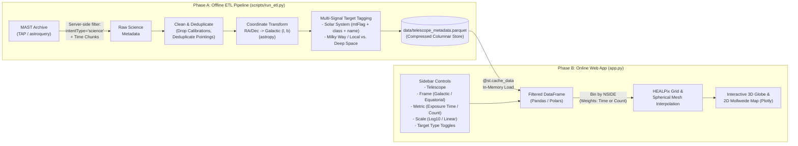

# Space Telescopes Observation Heatmap — Project Blueprint & Plan

> Consolidated from the initial design conversation in [Hubble Observation Heatmap Project.pdf](file:///Users/justmohesn/My%20Drive/Personal%20Projects%20with%20AI/Space%20Telescopes%20Observation%20Heatmap/Hubble%20Observation%20Heatmap%20Project.pdf) and updated with architectural refinements.

---

## 1. Project Vision & Scope

An open-source Python application and interactive web dashboard that visualizes where major space observatories (starting with **Hubble (HST)** and **James Webb (JWST)**, and extensible to **Chandra**, **Spitzer**, **XMM-Newton**, **Euclid**, **Herschel**, **Kepler**, and **TESS**) have pointed throughout their mission lifetimes.

Instead of downloading terabytes of raw astronomical imagery, the project queries observation **metadata catalogs** to build spherical heatmaps showing where humanity's space telescopes have spent the most time—or pointed most frequently.

### Key Capabilities & Interactive Toggles
- **Spherical & Projected Heatmaps:**
  - **3D Interactive Globe:** Users can spin, zoom, and inspect the celestial sphere in their browser, featuring explicit visual markers for the **Galactic Center** $(l = 0^\circ, b = 0^\circ)$ and the **Galactic Plane** ($b = 0^\circ$).
  - **2D All-Sky Projection:** Flattened **Mollweide projection** (both interactive in the app and exported as static high-res images for the GitHub `README.md`).
- **Interactive Filtering & Display Controls:**
  - **Telescope Selector:** Switch between observatories (`HST`, `JWST`, etc.) or view combined/comparative maps.
  - **Reference Frame Toggle:** Switch between **Galactic Coordinates** $(l, b)$ centered on the Milky Way center $(l = 0^\circ, b = 0^\circ)$ and **Equatorial Coordinates** $(\text{RA}, \text{Dec})$.
  - **Heatmap Metric Toggle (Duration vs. Pointings):**
    - **Cumulative Exposure Time (`t_exptime`):** Total seconds/hours the telescope stared at that region of the sky.
    - **Observation Count (`obs_count`) / Unique Targets (`target_count`):** How frequently the telescope pointed at that region, regardless of how long each exposure lasted.
  - **Color Scale Toggle:**
    - **Logarithmic Scale ($\log_{10}$):** Brings out the full structure of the sky so ultra-deep fields (like the Hubble Ultra Deep Field) don't wash out shallower surveys.
    - **Linear Scale (with optional percentile clipping):** Shows the raw, unscaled concentration of telescope time or pointings.
  - **Target Classification Filters:** Dynamically include or exclude:
    - **Solar System Targets:** Moving targets (planets, moons, asteroids, comets) whose sky coordinates depend on observation time rather than fixed deep-space directions.
    - **Milky Way & Local Group Targets:** Galactic disk pointings ($|b| < 10^\circ$), stellar targets, globular clusters, and major satellite galaxies like the Large/Small Magellanic Clouds (LMC/SMC).
    - **Deep Space / Extragalactic Targets:** High galactic latitude pointings looking out of the Milky Way into deep extragalactic space.

---

## 2. Technical Stack & Tooling

| Component | Technology | Role & Justification |
| :--- | :--- | :--- |
| **Python & Package Manager** | **Python 3.12** + **`uv`** | `uv` manages both the Python 3.12 installation (replacing `pyenv`/`conda`) and project dependencies/virtualenv via standard `pyproject.toml` and `uv.lock` (replacing `poetry`). |
| **Version Control** | `git` | Tracks source code and documentation while ignoring large local `.parquet` datasets and virtual environments. |
| **Data Retrieval** | `astroquery.mast` / `pyvo` (TAP / ADQL) | Queries STScI's Mikulski Archive for Space Telescopes (MAST) filtering server-side for science observations to avoid downloading calibration/engineering rows. |
| **Coordinate Math** | `astropy.coordinates` (`SkyCoord`) | Translates native Equatorial coordinates ($\text{RA}, \text{Dec}$) into Galactic coordinates $(l, b)$ centered on $(0^\circ, 0^\circ)$. |
| **Spherical Binning** | `healpy` (HEALPix) | Subdivides the sphere into equal-area pixels (`NSIDE` resolution), aggregates exposure times or pointing counts, and interpolates onto a smooth meshgrid for 3D rendering. |
| **Data Storage & Processing** | `pandas` / `polars` + `pyarrow` | Deduplicates, cleans, and serializes pre-computed datasets into compressed columnar `.parquet` files for millisecond in-memory loading. |
| **Interactive Visualization** | `plotly.graph_objects` / `matplotlib` | Renders interactive 3D globes and 2D projections in the browser (`plotly`), plus static publication-quality Mollweide maps (`matplotlib`). |
| **Web Application UI** | `streamlit` | Pure-Python reactive web framework that turns `app.py` directly into an interactive browser website without requiring separate HTML/CSS/JS code or a separate repository. |

---

## 3. Repository & Folder Structure

Everything—both the offline data pipeline and the interactive website—lives in a single, modular Python repository:

```text
Space Telescopes Observation Heatmap/
├── .git/                           # Git version control
├── .gitignore                      # Ignores .venv/, data/*.parquet, __pycache__, .DS_Store
├── .python-version                 # Pins Python 3.12 for uv
├── pyproject.toml                  # Project metadata & dependencies
├── uv.lock                         # Exact locked dependency versions for reproducibility
├── README.md                       # Open-source project overview & usage instructions
├── telescope_heatmap_blueprint.md  # Living architecture & implementation roadmap
├── data/                           # Local raw chunks & final .parquet files (git-ignored)
├── scripts/
│   ├── explore_mast.py             # Step 1: Inspect real MAST columns & target tags
│   └── run_etl.py                  # Step 2: CLI entrypoint to run the full ETL pipeline
├── src/
│   └── telescope_heatmap/
│       ├── __init__.py
│       ├── config.py               # Constants, paths, & telescope mission definitions
│       ├── etl.py                  # MAST TAP/API fetching, cleaning, & deduplication
│       ├── coordinates.py          # Astropy (RA/Dec -> l, b) & target classification logic
│       ├── binning.py              # HEALPix spherical binning (time/count, log/linear)
│       └── viz.py                  # 3D Plotly globe & 2D Mollweide chart builders
├── tests/                          # Unit tests for coordinate math, binning, & deduplication
└── app.py                          # Streamlit web application entrypoint
```

---

## 4. System Architecture

To prevent slow API queries or server timeouts inside the user interface, the system is strictly separated into an **Offline ETL Pipeline** and an **Online Web App**:



### Phase A: Offline ETL Pipeline (`src/telescope_heatmap/etl.py` & `coordinates.py`)
Runs locally to download, inspect, clean, and pre-compute the static dataset:
1. **Bulk Science-Only Fetching & Chunking:**
   - Queries MAST for `obs_collection="HST"` and `"JWST"` (filtering server-side for `intentType="science"` and valid sky coordinates/exposure times so hundreds of thousands of darks, biases, and engineering flats are skipped upfront).
   - Fetches in time chunks (e.g., 1-year `t_min` MJD intervals) with local checkpoint files so downloads are fast, resilient, and resumable.
2. **Data Cleaning & Pointing Deduplication:**
   - Extracts core columns: Observation ID (`obs_id`), Proposal ID (`proposal_id`), Telescope (`obs_collection`), Instrument (`instrument_name`), Right Ascension (`s_ra`), Declination (`s_dec`), Exposure Time (`t_exptime`), Observation Time (`t_min`), Target Name (`target_name`), Target Classification (`target_classification`), and Moving Target Flag (`mtFlag`).
   - Drops invalid rows (`s_ra`, `s_dec` null, or `t_exptime <= 0`).
   - **Deduplication:** Ensures multi-product/pipeline rows or duplicate archive entries for the same physical pointing (`obs_id` / overlapping sub-exposures) are deduplicated so neither exposure time nor pointing count is artificially inflated.
3. **Coordinate Transformation:**
   - Uses `astropy.coordinates.SkyCoord(ra=..., dec=..., unit="deg", frame="icrs").galactic` to compute Galactic Longitude $l \in [-180^\circ, 180^\circ]$ (or $[0^\circ, 360^\circ]$) and Galactic Latitude $b \in [-90^\circ, 90^\circ]$.
4. **Multi-Signal Target Classification:**
   - **Solar System (`is_solar_system`):** Combines three signals (to be refined during exploratory data inspection):
     1. MAST's moving target boolean flag (`mtFlag == True`).
     2. `target_classification` keywords (e.g., `SOLAR SYSTEM`, `PLANET`, `COMET`, `ASTEROID`, `SATELLITE`).
     3. Normalized `target_name` matching known planets, moons, dwarf planets, and minor bodies.
   - **Milky Way vs. Deep Space (`target_regime` / `is_milky_way`):**
     1. Geometric Galactic Disk check ($|b| < 10^\circ$, adjustable in ETL or UI).
     2. Catalog `target_classification` tags (e.g., `STAR`, `ISM`, `GLOBULAR CLUSTER`, `OPEN CLUSTER` vs. `GALAXY`, `AGN`, `QUASAR`, `DEEP FIELD`) and known Local Group hotspots like the Magellanic Clouds (LMC/SMC).
     3. *Note:* We will inspect the actual unique values of `target_classification` and `target_name` returned by MAST in Step 1 and refine these rules based on real data.
5. **Storage:**
   - Exports the clean, unified dataset to `data/telescope_metadata.parquet`.

### Phase B: Interactive Web App (`app.py`, `binning.py`, & `viz.py`)
Serves the exploratory dashboard in the browser (zero HTML/CSS/JS required):
1. **In-Memory Caching:** Loads `data/telescope_metadata.parquet` once per session using `@st.cache_data`.
2. **Sidebar Controls:**
   - **Telescope Select:** `HST`, `JWST`, or `All / Compare`.
   - **Reference Frame Toggle:** `Galactic (Milky Way Center)` vs. `Equatorial (RA/Dec)`.
   - **Metric Toggle:**
     - `Total Exposure Time (hours / seconds)`
     - `Observation Count (number of pointings)`
     - `Unique Targets Count`
   - **Scale Toggle:** `Logarithmic (log10)` vs. `Linear`.
   - **Target Category Filters:** Checkboxes/toggles for `Solar System`, `Milky Way Disk (|b| < 10°)`, `Local Stellar / LMC & SMC`, and `Deep Space / Extragalactic`.
3. **Dynamic HEALPix Binning:**
   - Converts filtered coordinates into HEALPix pixel indices (`healpy.ang2pix`).
   - Uses `numpy.bincount` weighted by `t_exptime` (for exposure time mode) or unweighted `1.0` (for pointing count mode).
   - Applies either $\log_{10}(\text{value} + 1)$ or linear scaling based on the user's toggle.
4. **3D Sphere & 2D Projection Rendering:**
   - **3D Interactive Globe:** Interpolates the HEALPix map onto a structured $(\text{lon}, \text{lat})$ spherical meshgrid via `healpy` and renders it with `plotly.graph_objects.Surface`, overlaid with a 3D reference vector/marker for the **Galactic Center** $(l=0^\circ, b=0^\circ)$ and the **Galactic Equator** ring.
   - **2D All-Sky Map:** Renders a flattened Mollweide projection alongside summary stats (total exposure hours, number of pointings, top observed targets under current filters).

---

## 5. Generalizing to Other Space Telescopes

Because the ETL normalizes columns into a single Parquet schema, adding more space telescopes only requires adding their query configuration to `config.py` and `etl.py`:
- **MAST Missions (`astroquery.mast`):** Hubble (`HST`), James Webb (`JWST`), Spitzer, Chandra, Kepler, TESS, GALEX.
- **ESA Missions (`astroquery.esa`):** XMM-Newton, Herschel, Euclid, Planck, Gaia.

---

## 6. Living Implementation Roadmap

As we build and explore the actual catalog data, we will update this section directly so this file remains our single source of truth.

- [x] **Step 0: Repository & Environment Setup (`uv` + Python 3.12 + Git)**
  - Installed `uv` (0.13.7), pinned Python 3.12 (`3.12.15`), initialized Git (`git init`), created `.gitignore` and `pyproject.toml`, installed and locked all 63 dependencies in `uv.lock`, and scaffolded the `src/telescope_heatmap/` package layout.
- [ ] **Step 1: Data Exploration & Prototype Query (`scripts/explore_mast.py`)**
  - Run a small sample query against MAST for `HST` and `JWST` to inspect available columns (`intentType`, `mtFlag`, `target_classification`, `s_ra`, `s_dec`, `t_exptime`, `obs_id`), row counts, and duplicate patterns.
- [ ] **Step 2: Offline ETL Pipeline (`etl.py` & `coordinates.py`)**
  - Implement chunked/resumable data fetching for HST and JWST.
  - Implement science filtering and pointing deduplication.
  - Implement `astropy` Galactic coordinate transformation $(l, b)$.
  - Implement and validate Solar System, Milky Way, and Deep Space classification rules using insights from Step 1.
  - Export `data/telescope_metadata.parquet` and print a data summary report.
- [ ] **Step 3: Core Binning & Static Visualization (`binning.py` & `viz.py`)**
  - Implement `healpy` binning supporting both **Exposure Time** and **Pointing Count** metrics, and both **Log** and **Linear** scales.
  - Generate static 2D Mollweide projection heatmaps (`matplotlib`) to verify coordinate orientation ($l=0^\circ, b=0^\circ$ at center).
- [ ] **Step 4: Interactive Streamlit Web App (`app.py`)**
  - Build the Streamlit UI with all dropdowns and toggles.
  - Build the interactive 3D Plotly globe (with Galactic Center marker & Galactic Plane ring) and 2D projection tab.
- [ ] **Step 5: Documentation & Polish**
  - Add unit tests (`tests/`), usage instructions, and static preview maps in `README.md`.
